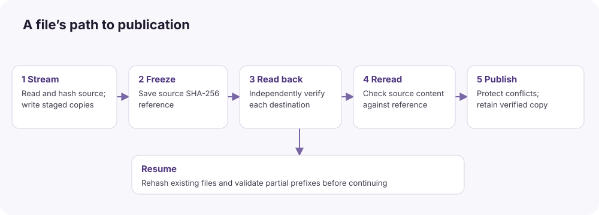

# Engineering reference

This chapter describes the v3.7 source snapshot. Rationale is an engineering interpretation of the code and recorded design requirements. It is not a claim that every alternative was benchmarked or formally rejected.

## Runtime and code organization

The Swift package uses tools version 5.9, declares macOS 14 as its minimum platform, and has no external Swift package dependencies. The delivered executable is arm64. A future build on another architecture is not the same as qualifying or distributing a universal binary.

| Layer | Principal files | Responsibility |
| --- | --- | --- |
| Native interface | `OKCopyApp.swift`, `QueueView.swift` | Source/destination controls, live folder tree, queue, history and status |
| Main-actor orchestration | `AppModel.swift` | User choices, background preparation, saved queue, report windows, notifications, activity assertions |
| Inventory and plan | `Plan.swift`, `BatchPlan.swift` | Enumeration, source protection, exact output mapping, collisions, free-space checks, identities |
| Shipping transfer path | `TransferEngine.run`, `ManagedTransfer.swift` | Safety gate and coordinated execution |
| Data movement | `CopyPipeline.swift`, `DestinationPipe.swift`, `SafeIO.swift` | Bounded streams, writer channels, checked I/O and publication |
| Storage coordination | `StorageScheduler.swift` | Best-effort resource discovery and ordered locking |
| Recovery | `TransferQueue.swift`, `SourceChecksums.swift`, `ReportRecovery.swift` | Saved plans, frozen hashes, partial state and report export |
| Interchange | `BatchReport.swift`, `CopyReports.swift`, `MediaManifest.swift`, `XXH64.swift` | HTML/JSON, selected MHL formats and standalone verification |
| Regression/reference | `Engine.swift`, `TransferEngine.legacyExecute` | Older implementations; not the GUI queue coordinator |

The entrypoint recognizes `--self-test` and otherwise launches the GUI. The source also includes an isolated sample/demo path. There is no documented general-purpose command-line import interface comparable with rsync.

## Tool choices and tradeoffs

| Choice | Why it fits this application | Cost or limit |
| --- | --- | --- |
| SwiftUI plus AppKit | Native controls and window integration, with AppKit folder panels and report windows | macOS-specific; OS-version appearance differences need testing |
| Darwin file descriptors | Explicit read-only sources, exclusive writes, anchored traversal, flush points and owned partial files | More implementation and testing responsibility than a single high-level copy call |
| CryptoKit SHA-256 | Incremental cryptographic digests through a system framework; one authoritative ingest algorithm | Hashing and extra reads consume time; no signature or identity authentication follows automatically |
| Bounded read/hash and writer queues | Overlap stages without holding entire media files in memory | Backpressure remains; fixed buffer sizes are not an adaptive hardware optimizer |
| JSON immutable plans | Inspectable saved work, backward-compatible optional fields, clear source/output mappings | Inventory and receipt memory/storage grow with file count |
| HTML plus JSON receipts | Readable presentation and structured evidence without proprietary viewers | Not the PDF/CSV/TXT suite supplied by some media tools; receipts are unsigned |
| Quick Look thumbnails | Use installed macOS preview support without shipping camera SDKs | Unsupported formats show a placeholder; no promise of professional RAW/video metadata extraction |
| Disk Arbitration and IOKit | Read-only hints about shared disks and USB ancestry | Bridges, RAID and virtual storage can obscure physical relationships |
| WebKit report display | Native resizable window, HTML layout and print-friendly file format | Rendering is an OS dependency; receipt inspection is not report authentication |
| Local/ad-hoc signing | Integrity check for this development artifact without distribution credentials | Does not substitute for Developer ID, notarization or clean-Mac qualification |

Apple documents incremental hash updates in [CryptoKit](https://developer.apple.com/documentation/cryptokit/sha256/init%28%29). That supports chunked operation; it does not justify claiming that Swift removes all unsafe memory handling. This code deliberately crosses into POSIX APIs, uses locks, and marks some shared types `@unchecked Sendable`; those areas require continued review.

## Why not simply combine rsync, fcopyfile and FileManager?

They are different abstractions. Swift is the implementation language; Darwin calls are native macOS/Unix I/O; `fcopyfile` is another native copying primitive; rsync is a separate synchronization program. “Native engine” is not a single competing product or a security level.

Apple's `copyfile`/`fcopyfile` API provides copying, metadata options and callbacks, with documented cloning-related options. Those capabilities are useful primitives, but do not independently provide this app's job queue, multi-target failure policy or saved verification references. The shipping coordinator does not call fcopyfile as its transfer backend. [Apple copyfile manual](https://github.com/apple-oss-distributions/copyfile/blob/main/copyfile.3)

Adding several backends would require equivalent verification, source protection, resume journals, publication behavior, cancellation and report semantics for each. A faster unverified path would change the product's contract. A high-level copy may also require a separate checksum read and cannot automatically share one streamed source pass among several independently managed writers.

Rsync can be a good backend for another design, especially remote synchronization. Here it would add a process boundary, version/option interpretation, and status mapping while the application still needs its policy layer. This is a rationale for the current implementation, not evidence that rsync is inherently less secure or slower. See the [comparison](WHITE-PAPER.md#compared-with-rsync) for the distinction between its pre-transfer and transferred-file checksums.

The engine does not treat hard links or filesystem clones as separate backup copies. Sharing an underlying file or copy-on-write extents on one storage device is a different operation from writing and checking another destination. Independent file paths also do not by themselves establish independent hardware fault domains.

The historical fcopyfile comparison tool remains in `Tools/CompareEngines.swift`. A small cached test does not select the fastest engine for SD, CFexpress, USB, APFS, exFAT or network hardware. No multi-engine automatic selector is implemented.

## Planning and output mapping

CardScanner enumerates directories with descriptor-based traversal. It accepts regular files, rejects links/special files, and sorts the file inventory. Known housekeeping exclusions are explicit rather than a blanket “skip all hidden files.” Source root protection is broader for externally mounted volumes, including when only DCIM is selected.

BatchPlanner refreshes inventories, validates source labels, creates destination identities, computes intended paths, rejects collisions, and checks required capacity. Names are compared conservatively with normalized, case-insensitive keys so a plan cannot depend on a case-sensitive destination to keep otherwise-colliding files distinct. Source labels are formatted identifiers; project folder names are exact user text subject to validation.

The three layouts are:

```text
Organized: Originals > Source Folders
Destination/Project/Originals/CARD-A/relative/file

Into Folder, one source
Destination/Project/relative/file

Directly into destination folder, one source
Destination/relative/file

Into Folder or Direct, multiple sources
[Project or Destination]/CARD-A/relative/file
[Project or Destination]/CARD-B/relative/file
```

Every destination receives the same logical mapping. Destination-local reports use `Ingest Reports` below the mapped project/root; optional MHL files are at that root. The hidden `.OKCopy` workspace is separate from visible originals but remains necessary recovery state.

One destination is sufficient. Destination folders cannot contain one another. Protected sources cannot also be destinations. Required space is summed across destination folders sharing a filesystem. Compatible publication adds headroom based on large active files and configured source concurrency, in addition to the planner's report reserve. These are preflight estimates; free space can change during a transfer.

## Optional review versus immediate copying

A reviewed job uses plan schema 2, containing precomputed SHA-256 references. Review scans and hashes source files, checks intended existing copies, identifies duplicate content, and produces a dry-run report without creating destination media files. Temporary app-side review artifacts can still be written.

An immediate job uses schema 3 with `hashDuringCopy = true`. It performs path/inventory/capacity preparation but leaves file hashes unresolved until the streamed source read. It then saves each resolved reference through SourceChecksums before publishing the corresponding final media file. Those references are written once and compared on resume.

Review improves observability before writes; it is not required to turn on SHA-256 verification. It normally adds I/O, so it should not be marketed as a speed optimization. An unstarted immediate plan cannot establish the byte contents before its first actual source read: identical size/time metadata alone is not a cryptographic baseline.

## Execution and integrity sequence



For each file, the shipping path proceeds through these steps:

1. Reopen the source read-only and check its current stamp against the refreshed inventory.
2. Load any saved source references from healthy job workspaces; incompatible references abort source acceptance.
3. Rehash existing intended destination files, or validate retained partial prefixes against the source. Preserve invalid partials under rejected names before restarting.
4. Read and hash source chunks through a bounded pipeline; fan chunks out to destination-specific writer queues, skipping already retained valid prefixes where appropriate.
5. Join writer operations and check source stamp, stream length and any existing expected hash.
6. Save resolved source SHA-256 references in healthy workspaces before final-file publication.
7. Apply modification times to staged files, flush, read back each new staged copy, and compare SHA-256. Compute SHA-1 too only when manifest export requires it.
8. Reread the source and compare its digest again; check its stamp before accepting completion.
9. Publish each healthy verified file without replacing unrelated existing data. Compatible publication has its own checksum/journal checks.
10. After file and source-inventory completion, generate requested manifests, publish a new staged project, and save destination receipts. Record eligible pending report payloads for export-only retry.

FileStamp records device, inode, size and modification-time fields. The particular checks differ between plan validation, refreshed inventory checks and open-descriptor checks; they are not a single authenticated source-device identity protocol. SHA-256 remains the content acceptance reference once captured.

## Concurrency, scheduling and memory

The source read/hash channel can queue two 8 MiB chunks. Each destination writer has its own two-chunk waiting queue, plus active data and other buffers. Bounds are independent of a single file's length, but peak memory is not universally 16 MiB: active workers, Data values, destination count, hashing, previews, file inventories and receipt tables all contribute.

Concurrent source processing is selectable from 1 to 4, default 2. Sources with intersecting discovered resource keys are merged transitively into serial groups. Each active source file can use up to four destination readback operations. That is a per-file limit, not a global promise of at most four verification threads.

StorageScheduler acquires sorted resource locks for destination write/readback operations. Discovery can add filesystem, whole-disk, physical-device and USB-ancestor keys. It does not measure USB bandwidth or control the transport controller. Not every source read is wrapped in the same resource lock; the implementation should not be described as a universal hardware scheduler.

More parallelism is not always faster. Several sources and destinations may compete on one reader, hub, SSD or APFS container. Bounded queues absorb short stalls; they do not allow a consistently slow direct-mode destination to lag arbitrarily far behind.

## Publication and durability

On a volume supporting exclusive rename, a new project starts in a hidden staging directory and is renamed to the requested exact name after completion. Each verified file is moved exclusively within that project. Existing incremental projects can receive completed files before the entire job finishes.

For filesystems without the protected rename operation, the compatible path creates a new final file with exclusive creation, records its identity and digest in a publication journal, copies from the verified staging file, flushes and rehashes the final file, confirms the path still identifies the opened output, and retires staging data only after success. An interrupted owned final publication can be resumed after prefix checks. An unowned existing file is not adopted for writing.

The implementation uses fsync and F_FULLFSYNC at selected points, with explicit handling for unsupported drive-cache flush operations. Some directory flush results are best-effort. Storage hardware, filesystems, bridges and sudden power loss can still defeat assumptions; this is not a formal crash-consistency or power-failure guarantee.

## Queue, resume and report recovery

TransferQueueStore writes immutable per-job plan JSON and atomically replaces queue metadata. It serializes access with a lock and flushes important files/directories. A previously running job restores as paused. No restored job starts automatically. Resume on one job runs that job; Start Queue deliberately runs queued work in order. A failed job stops further queue processing after healthy destinations in that job have had an opportunity to finish.

Resume never treats a saved completed flag or byte offset as proof. It rechecks sources, destination identity, existing files and partial prefixes. A completed primary with a valid cascade-ready marker can support backups without the original card, but the working copy is freshly checked before it is used.

A report failure is not the same as media corruption. When an eligible completed destination retains `PendingReport.json`, Retry Report Export can recreate its HTML/JSON receipt without source reads or media transfer. It locks the job workspace, checks ownership and destination identity, respects source/report overlap checks, and removes the pending record after export. Recovery payloads are limited to 128 MiB. This exports the frozen verification event; it does not reverify current files and does not regenerate an unsuccessful MHL export.

## Reports, interchange and security

HTML presents outcomes, source/output paths, digests and advisories. JSON carries structured plan and receipt data with a schema identifier and app version. A per-destination report can contain verification rows for several destinations; its heading is destination-specific, and missing receipt rows are explicitly Not verified. New v3.7 destination success headings say Verified. Colors support the text rather than replacing it.

Optional exports are legacy MHL 1.1 and flat ASC MHL 2.0 using destination SHA-1 readback values. SHA-256 remains authoritative for ingest. SHA-1/MD5 support is for compatibility, not an assertion that they are suitable modern authenticity mechanisms. XXH64 is non-cryptographic and is only a supported comparison format here, not the ingest acceptance algorithm. [xxHash project](https://github.com/Cyan4973/xxHash) Full ASC directory hashes, root hashes and history references are not implemented; the verifier rejects those structures. The ASC ecosystem explicitly includes custody/history concepts beyond this flat export. [ASC specification](https://github.com/ascmitc/mhl-specification)

Standalone verification accepts selected UTF-8 MHL documents or the app's SHA-256 JSON receipts, with a 128 MiB input limit. It checks listed paths relative to a user-selected root, detects missing/changed files, rejects unsafe traversal and links, rejects XML DTD/entity declarations, checks supported hashes, and reports unrecognized checksum fields as unsupported. It does not certify extra unlisted files.

Reports display in a native resizable WebKit window with JavaScript disabled and a nonpersistent website data store. Saved reports include filesystem paths, filenames and workstation-related metadata; review them before external sharing. They are not digitally signed, tamper-evident custody records, or encrypted archives. A user or compromised process with write access can alter a receipt and its hashes.

## Progress and ETA

The recent copy/readback speeds sample separate byte counters at intervals of at least half a second. The older Avg I/O field combines copied and readback bytes over elapsed time. Neither number is a guarantee of raw device throughput. Speeds shown for stopped jobs are zero current speed, not a claim the transfer ran at zero speed.

ETA uses an exponentially smoothed work rate with an eight-second time scale and a three-second warm-up. The normal per-destination work budget is 4 × source bytes: source copy read, destination write, destination readback, and source reread. Compatible publication raises the modeled budget to 7 × bytes. Retained prefixes and reused files receive credits; publication work is modeled in coarse credits. Estimates expire in the queue after stale updates and are cleared on restoration.

Cascading initially estimates waiting backups using the working-copy rate and conservative sequential backup work; it then uses backup observations. Stage progress is mapped across primary and backup portions. Changing hardware rates, extra resume checks, OS caching, source inventory scans, manifest/report generation and unmeasured finalization mean this is an approximate job estimate, not a promised completion clock. No estimate is fabricated for a future unstarted queue of jobs.

## Building and maintaining

Run the included source snapshot from a writable development copy outside a signed application bundle. Editing bundle contents invalidates the signature. A compatible Swift/macOS SDK toolchain is needed to build, although it is not needed to run the packaged app.

```bash
cd source/OK-Copy
bash build-app.sh
```

The script runs XCTest, builds an optimized executable, generates the icon, embeds source and documentation, applies local signing, runs the app's safety check, and builds/runs workflow, publication and immediate-copy checks. The output app is created one directory above the package. `OKCOPY_BUILD_DIR` can put caches outside the source copy. The script uses `--disable-sandbox` for its build/tooling process; that is not an app security capability and does not mean the packaged app is App Store sandboxed.

For source review, start with `ManagedTransfer.execute/direct/copy`, then follow SafeIO publication, SourceChecksums and ReportRecovery. Legacy engines remain useful regression references but must not be mistaken for the shipping coordinator. Maintain verification and recovery semantics across any future backend experiment before making comparative speed claims.
