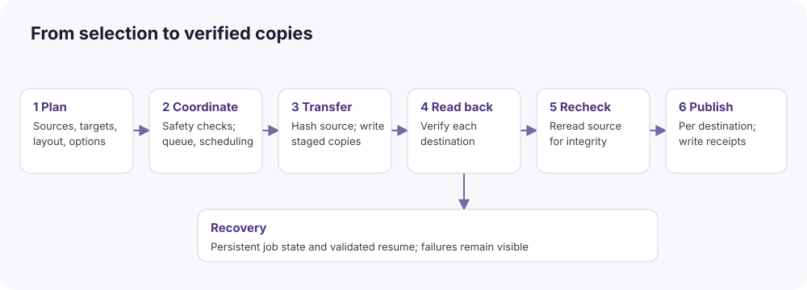
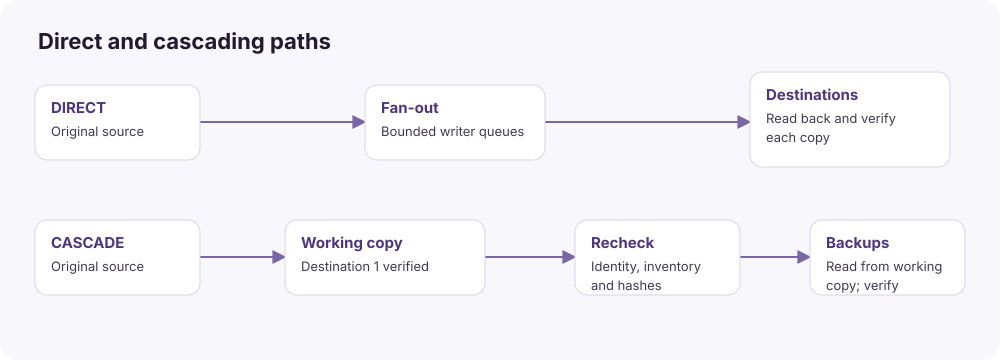

# White paper

**OK, Copy 3.7 · build 13 · implementation reference dated October 30, 2026**

## Executive summary

OK, Copy is a focused, native macOS verified-copying application. Its central operation is a saved copy job: selected source folders, intended output paths, chosen destinations, verification policy, and report placement are recorded before transfer. The app copies regular file contents, verifies each destination against source SHA-256 references, and keeps enough private state to recheck and resume interrupted work.

The product grew from a photography ingest workflow into a more general verified copying tool. It supports photos, video, sidecars, and other regular files; file extension does not determine whether a file is copied. One internal destination is valid. Two folders on the same disk are also allowed, although they do not constitute independent protection against that disk failing.

Its most useful distinction is the integration of a narrow safety policy, visible verification, recoverable partial files, and user-readable receipts in a small source-included app. It is not established to outperform professional offload software, and its current validation does not establish equivalent field maturity.

## Key capabilities

| Capability | User benefit | Important boundary |
| --- | --- | --- |
| Multiple source folders and destination folders | One job can represent several cards and copies | One queue job runs at a time; source workers within it can overlap |
| SHA-256 copy acceptance | Successful destinations are checked against source content | Matching bytes do not establish media decodability or provenance |
| Independent destination status | A failed backup need not prevent healthy destinations finishing | Source-integrity problems prevent overall success |
| Saved jobs and partial-file resume | Restart or reconnect and continue after rechecking existing data | Saved offsets are not trusted; source availability usually remains necessary |
| Cascading | Backups can read a verified working copy instead of the card | The primary must remain available and pass fresh checks |
| Three folder layouts | Choose structured ingest or direct folder copying | Multiple sources retain separate labels to avoid ambiguous output paths |
| Optional Review Copy | Inspect checksums and conflicts before writing destinations | Adds a source read and possibly existing-copy reads |
| Report history and standalone re-verification | Recover past receipts and check files later | A saved receipt is an event record, not continuous monitoring |
| Export-only receipt recovery | Retry eligible report writes without copying media again | Requires a retained pending receipt; manifest failures use Resume |
| Native preview and feedback | Inspect source lists, thumbnails, progress, and errors | Quick Look support varies with installed macOS capabilities |

## What Verified means

For an ordinary successful copy, the engine hashes a source read while sending chunks to destination writers, flushes each staged copy, reads that staged copy back, compares its SHA-256 to the source digest, rereads the source, and checks that the source still matches. The final file is then published without replacing unrelated destination data. Additional validation applies when publication itself needs a compatible copy operation.

Review Copy establishes a pre-transfer baseline. Start Copy can instead establish the baseline during the transfer. For that immediate mode, write-once source references are saved in destination-owned recovery workspaces before final-file publication. Subsequent attempts compare against these references; they do not silently redefine the original checksum to match changed content.

A **Verified** destination receipt refers to that destination's completed verification. A job succeeds only when its required copies and completion steps succeed. A report/export problem can leave valid, published files while the queue still requires attention. Receipts distinguish destination-specific outcomes from all-destination completion.

A checksum comparison is evidence about byte equality at a particular time. It does not certify the camera's recording, exclude pre-existing corruption, establish copyright or chain of custody, or predict a memory card's remaining life. A second read through macOS can be served partly from caches; independent readback is a separate read operation, not a claim that every byte was retrieved freshly from the physical NAND.

## Architecture and transfer modes

The GUI uses AppModel to prepare and save immutable plans. TransferEngine applies a startup generated-file safety gate and delegates to ManagedTransfer. That coordinator owns source work, per-destination writers, checksum checks, publication, and reporting. SafeIO provides anchored path traversal and exclusive destination creation. StorageScheduler uses available macOS topology information to limit contention on detected shared resources.

In **direct mode**, one streamed source-copy pass fans chunks out to independent bounded destination queues. This avoids reading the card once per destination during that pass. It does not mean a file is read only once overall: source rechecking, optional Review Copy, prefix validation, and cascading add reads. Short writer stalls can be buffered; a sustained slow writer eventually applies backpressure to the shared source stream.

In **cascading mode**, destination 1 is the working copy. After that copy is verified and published, its planned files are checked again and used as backup sources. This can release the original card from the backup stage sooner. It shifts later read load to the working drive; it does not guarantee the shortest total completion time.

## Non-destructive source policy

The app does not expose erase, format, repair, or move-original operations. Source contents are opened read-only. Source links and special files are rejected, destinations cannot overlap protected sources, and external/removable source volumes receive broader protection than a single selected subfolder. Reports and queue storage are also checked against protected locations.

This is an application policy, not a hardware write blocker. macOS and other applications can still access a mounted card; automatic filesystem activity is outside this program's guarantee. The app also cannot make two destinations physically independent merely by assigning different folder names. Those distinctions matter when interpreting “source files stay untouched.”

## Where this app offers a practical advantage

### Compared with Finder

Apple documents Finder drag-and-drop as a general file movement/copying interaction. OK, Copy adds a specific ingest workflow: saved plans, several destination outcomes in one job, fixed checksum acceptance, private recovery state, and machine-readable receipts. That is an operational advantage for a user who needs evidence of copying. It is not a claim that Finder's internal copy implementation has no integrity checks or that Finder cannot run multiple copies. Finder remains the broader tool for ordinary file management. [Apple Finder guidance](https://support.apple.com/en-sg/guide/mac-help/mh35852/mac)

### Compared with rsync

Rsync already has transfer verification: its manual distinguishes the normal transferred-file checksum from the pre-transfer `--checksum` decision. It also offers local/remote copying, partial-transfer options and broad metadata controls. OK, Copy's advantage is an integrated GUI policy and reporting workflow, rather than a claim that rsync lacks checksums. Rsync is more flexible for scripting, network synchronization and mirroring. Its installed version and options matter; current upstream documentation does not describe every macOS-bundled binary. [Rsync manual](https://download.samba.org/pub/rsync/rsync.1.html)

OK, Copy also avoids the need for an operator to construct several commands, choose potentially destructive synchronization flags, and assemble a separate report system. A carefully engineered rsync wrapper could supply many of those same workflow benefits.

### Compared with Hedge OffShoot

Hedge documents configurable verification modes, including full source-and-destination readback. OK, Copy instead makes SHA-256 destination acceptance part of its fixed ingest policy. This reduces configuration ambiguity for this particular workflow; it is not a claim that OffShoot cannot verify destinations thoroughly. [OffShoot verification](https://docs.hedge.video/offshoot/features/verification)

A concrete distinction is partial-file handling. Hedge's documented Stop & Resume workflow restarts incomplete files rather than resuming inside them. OK, Copy can recheck a retained partial prefix and append the remaining content, then verify the whole result. Its benefit depends on a valid retained prefix and storage conditions; this is not a timed comparison. [OffShoot Stop & Resume](https://docs.hedge.video/offshoot/features/stop-and-resume)

Hedge documents duplicate skipping based on destination path, size and modification date; OK, Copy rehashes intended existing paths before accepting a skip. That trades additional reading for content-based confidence. OffShoot also has wider production workflows and ASC history handling that this application does not reproduce. [Duplicate detection](https://docs.hedge.video/offshoot/features/duplicate-detect), [verification and ASC history](https://docs.hedge.video/offshoot/features/verification)

### Compared with OWC Copy That

OWC documents multiple destinations, several hash choices, presets, job archives, MHL, and PDF/TXT/CSV reporting. Those are shared or broader capabilities, not unique advantages of OK, Copy. This app's reasons to choose it are its inspectable source-included policy, fixed SHA-256 ingest acceptance, three tailored layouts, and its particular recovery implementation. Copy That offers richer documented report/media workflows; no controlled comparison establishes which product is faster or more reliable. [OWC Copy That](https://www.owc.com/solutions/copy-that), [OWC support](https://software.owc.com/support/copy-that/)

The proprietary internals of the commercial products were not inspected. Claims about their private threading core, filesystem optimization layers or TCP tuning are therefore not inferred from feature names or marketing descriptions.

## Decision matrix

| Requirement | OK, Copy v3.7 | Alternative to consider |
| --- | --- | --- |
| Transparent, tailored, source-included macOS workflow | Strong fit within the documented scope | Source inclusion alone does not establish a license or maintenance service |
| Content recheck before reusing an existing intended path | Built into incremental copying | Other tools may support different policies/configuration |
| Reuse valid partial files after interruption | Verified prefix recovery | Compare actual resume policy, not just a Resume button |
| Full metadata, links, empty directories, general file management | Limited or rejected | Finder or an appropriately configured general copy/sync tool |
| Remote transfer and synchronization | Network destinations rejected | Rsync or a qualified network-capable production tool |
| Rich camera SDK metadata, professional reporting formats | Quick Look and HTML/JSON are more limited | Copy That and other established media tools |
| Full ASC history and chain validation | Not implemented | A qualified history-aware ASC MHL tool |
| Proven sustained hardware performance and commercial support | Not established by current evidence | Evaluate supported commercial products against your requirements |

## Performance and reliability boundaries

There is no valid performance ranking among these products in this repository. Old cached sample experiments are not sustained card benchmarks, and vendor speed claims use their own test conditions. The app's 8 MiB chunks, bounded queues and controlled concurrency are design choices, not evidence of a particular MB/s rate.

New immediate jobs normally require two full source reads: the streamed copy/hash pass and source reread. Review normally adds another full source read before execution. Each new destination receives a write and readback. Compatible publication can add a staging read, final write and final readback. This additional I/O is the cost of the chosen verification/publication policy.

Local signing and 67 automated tests do not establish safe behavior under every power interruption, storage bridge, filesystem, media defect or macOS release. The current record covers generated data; large real SD/CFexpress transfers, physical interruption qualification, comprehensive accessibility checks, and notarized clean-Mac distribution remain outstanding. See [Validation and limitations](VALIDATION.md).

## Appropriate use

Use OK, Copy when you want a focused, inspectable local verified-copy workflow and can evaluate its development-stage qualification honestly. Keep originals until your independent copies and broader backup policy are satisfied. For production requirements involving full ASC custody, specialized camera SDKs, remote storage or vendor-backed hardware qualification, compare the requirements explicitly instead of treating a similar feature name as equivalent implementation.
